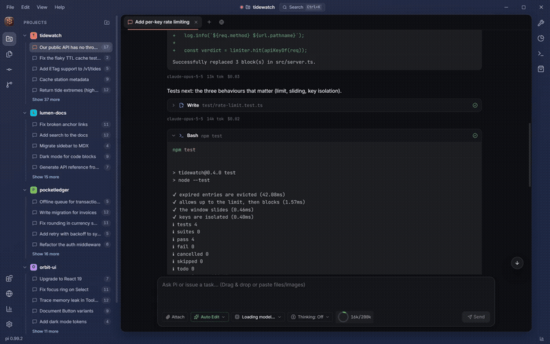
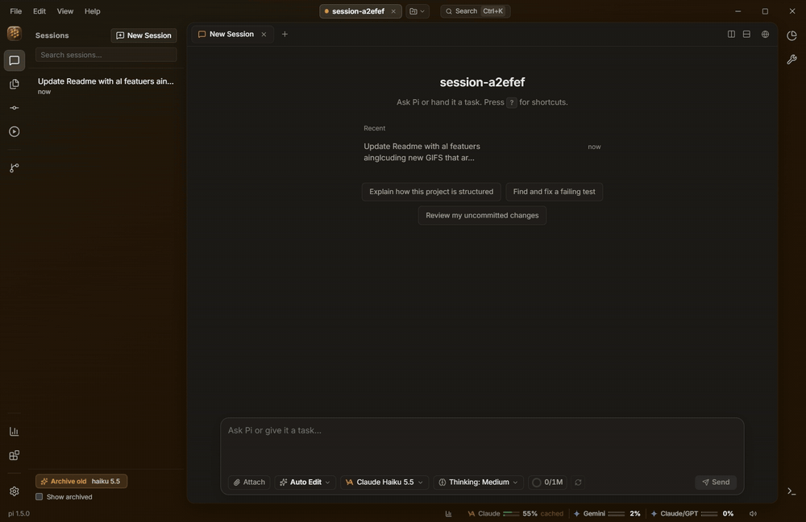
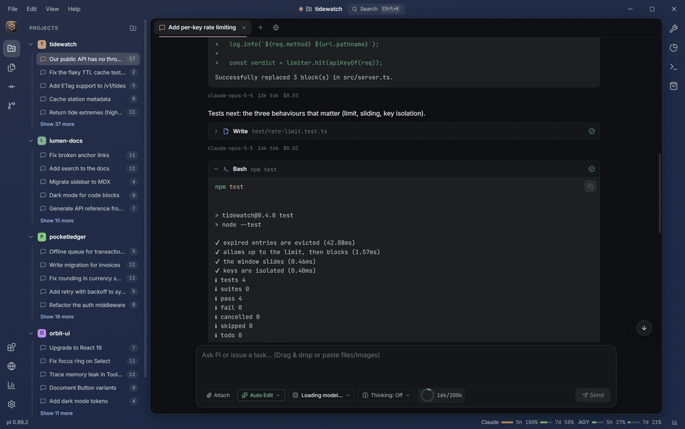
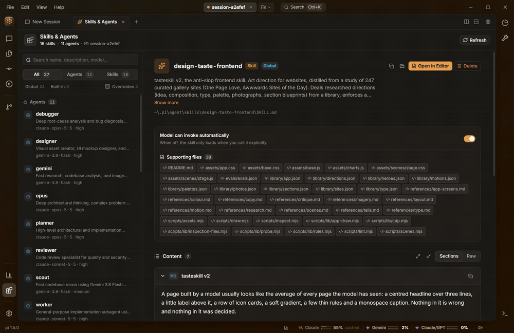
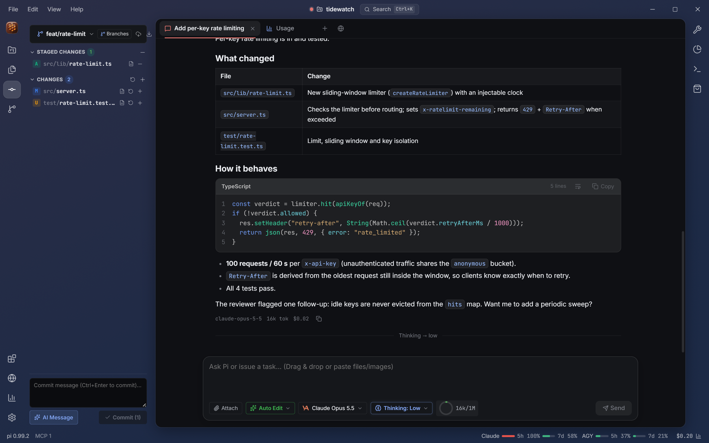
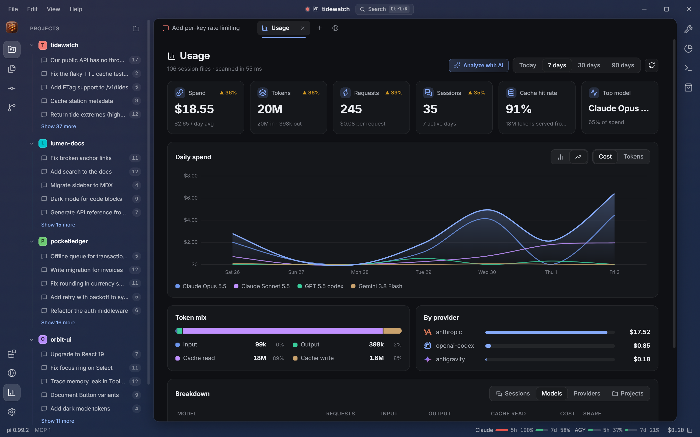
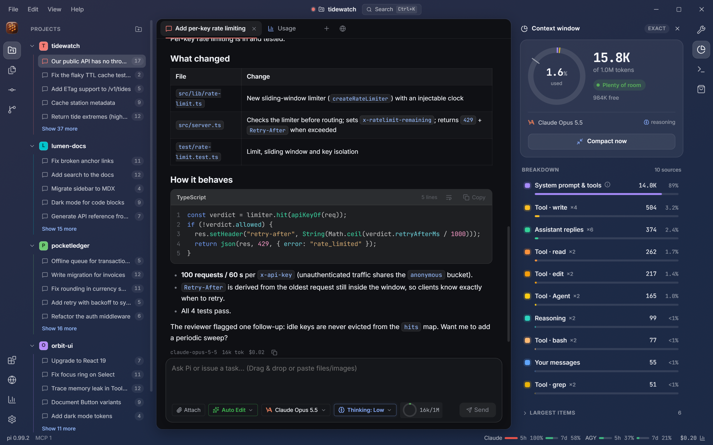
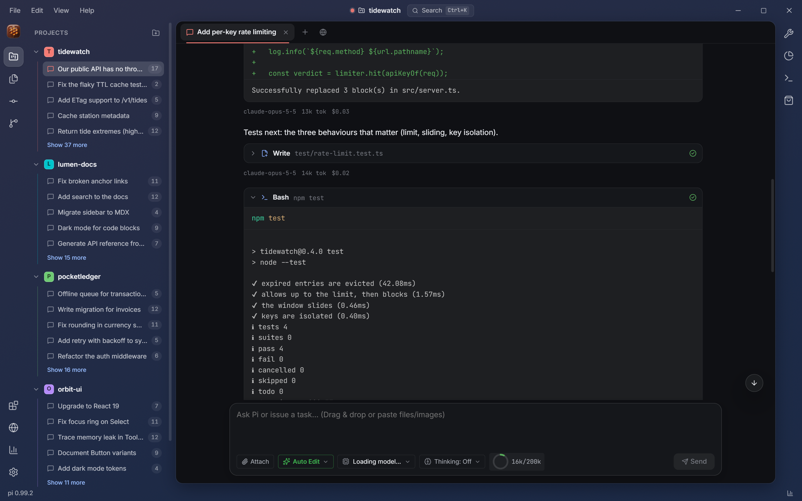
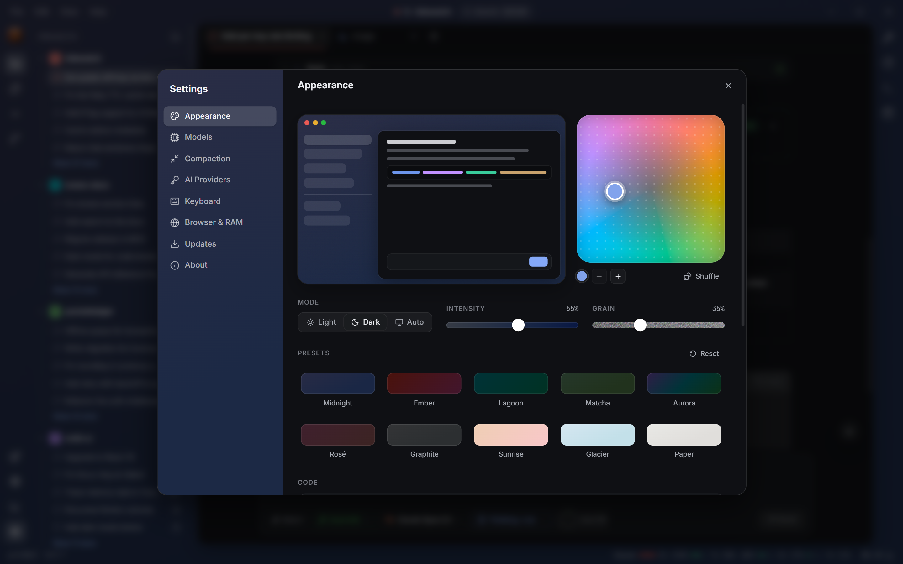

<div align="center">


# Hive

**Desktop workbench for the [Pi coding agent](https://pi.dev).**  
Parallel sessions, git worktrees, live subscription limits, local cost analytics, and a built-in terminal, browser, and git client — all driving your local Pi CLI.

[](https://github.com/AdielMag/Hive/actions/workflows/release.yml)
[](https://github.com/AdielMag/Hive/actions/workflows/ci.yml)
[](https://github.com/AdielMag/Hive/releases/latest)



</div>

## Features

### Work on many things at once

- **Project tabs & sessions** — Color-coded project tabs in the top bar; every Pi session on disk in one sidebar, resumable in a click. Tabs and pane layouts are remembered per project.
- **Split panes** — Split horizontally or vertically, drag tabs between panes, and run sessions side by side.
- **Git worktree isolation** — Branch-per-session under `.hive-worktrees`, with ahead/behind/dirty status, AI auto-commit, one-click merge, and AI-assisted 3-way conflict resolution.
- **Pending dialogs everywhere** — Approvals, forms, and guard prompts surface in background panes and parked tabs, so nothing waits unseen.
- **Archive old sessions** — A tidy tab uses a model of your choice to triage stale sessions and bulk-archive them, with undo and worktree cleanup.

### Drive the agent

- **Composer** — `@file` and `/command` autocomplete, shell-style Up/Down prompt history, and attachments.
- **Message queue** — Queue *steering* messages mid-turn or *follow-ups* for after; edit, reorder, or hit **Do now**.
- **Five agent modes** — `auto-edit`, `ask`, `plan`, `manual`, `debug`; Hive announces each switch to the agent. <kbd>Shift</kbd>+<kbd>Tab</kbd> cycles modes, with a reasoning-effort selector alongside.
- **Transcript inspection** — Collapsible thinking, batched tool cards with diffs, and subagent cards with tokens and cost.
- **Auto session titles** — Short AI titles generated in the background after your first message.
- **Plan review** — Agent plans open in a rich tab with decisions, callouts, inline annotations, and approve / request-changes.
- **Bash guard** — Destructive commands (`rm -rf`, `git reset --hard`, …) pause for approval with a plain-language explanation and fast Jev risk triage.

### See what it costs

- **Subscription limits** — 5-hour and weekly quotas for Claude, Google Antigravity, and Codex in the status bar, with reset countdowns and live refresh.
- **Usage analytics** — Offline spend, token, and cache dashboards from your local session files; scope by project; break down by model and subagent.
- **Context window** — Token ring with warning thresholds and a per-category breakdown (instructions, tools, skills, history).
- **Compaction advice** — Jev spots task boundaries and cold prompt caches to suggest when to compact.
- **Tools inspector** — Loaded skills, subagents, and MCP servers, plus ranked tool usage with failure rates and jump-to-transcript.

### Ship the code

- **Git panel** — Stage, commit, push, pull, and fetch, with AI-written commit messages.
- **Branches & graph** — Commit graph, branch switch/create/delete (local and remote), and per-commit diffs.
- **GitHub Actions** — Runs, jobs, and step logs; dispatch workflows; one-click **Fix it** spawns an agent on a failed run.
- **Files & diffs** — File tree with search and rename/delete; viewer with syntax highlighting, side-by-side or unified diffs, Markdown/JSON/HTML/SVG previews, and inline **Ask Pi**.
- **Terminal** — Integrated xterm.js terminal (PowerShell, bash, zsh) docked or in a tab.
- **Browser** — Integrated Chromium with devtools and automatic tab hibernation to save RAM.

### Make it yours

- **Skills & agents library** — Browse, create, and edit Pi skills and subagents with a frontmatter editor.
- **Marketplace** — Discover and install Pi packages, Claude plugins, and MCP servers from npm and the MCP registry.
- **Modules** — Lean by default; pick Minimal, Recommended, or Everything and toggle modules anytime.
- **Themes** — Arc-style 2D hue/chroma picker, light/dark/auto, grain and glass, WCAG-checked contrast.
- **Keyboard first** — <kbd>Ctrl</kbd>+<kbd>K</kbd> command palette, <kbd>?</kbd> shortcut cheatsheet, and rebindable keys.
- **Local only** — No telemetry, no cloud relay. Talks to your `pi` CLI over JSON-RPC.

### Tour

**Workbench** — sessions, files, git, Actions, branches, terminal



**Insights** — limits, usage, context, source control



**Customize** — skills library, marketplace, themes



<details>
<summary>Screenshots</summary>

| | |
|---|---|
|  |  |
|  |  |
|  |  |

</details>

## Quickstart

Needs Node.js **22.19+** and Pi, signed in once:

```bash
npm install -g @earendil-works/pi-coding-agent
pi
```

Download Hive from the [latest release](https://github.com/AdielMag/Hive/releases/latest) (Windows `.exe`, macOS `.dmg`, Linux `.AppImage`), then open a project folder.

> [!NOTE]
> Binaries are unsigned. Windows: *More info → Run anyway*. macOS: right-click → *Open*.

Press <kbd>Ctrl</kbd>+<kbd>,</kbd> for settings (<kbd>Cmd</kbd> on macOS).

## Configuration

| Variable | Description |
|---|---|
| `HIVE_PI_CLI` | Path to Pi's `cli.js`, package root, or binary (skips auto-detection). |
| `HIVE_NODE` | Node.js executable (≥ 22.19). |
| `HIVE_PROJECT` | Folder to open on startup. |
| `PI_CODING_AGENT_DIR` | Pi data directory (default `~/.pi/agent`). |
| `HIVE_USER_DATA` | Custom Hive profile directory. |

## Development

```bash
git clone https://github.com/AdielMag/Hive.git
cd Hive
npm ci --legacy-peer-deps
npm run dev
```

| Command | Purpose |
|---|---|
| `npm run build` | Production build |
| `npm run typecheck` | Type-check all packages and modules |
| `npm run lint` | ESLint |
| `npm test` | Unit tests (`npm run test:contract` for contract tests) |
| `npm run check:modules` | Verify generated module registry and boundaries |
| `npm run dist` | Package installers |
| `npm run screenshots` | Regenerate `docs/screenshots/*.png` |
| `npm run gifs` | Regenerate the tour GIFs (needs `ffmpeg`; run `npm run build` first) |

### Architecture

| Path | Role |
|---|---|
| `apps/desktop` | Electron app (main, preload, renderer) |
| `modules/*` | Feature modules (git, limits, analytics, terminal, browser, …) loaded through the module SDK |
| `packages/module-sdk` | Contract between Hive core and modules |
| `packages/pi-adapter` | The only place Hive couples to Pi: RPC process, framing, transcript reconstruction |
| `packages/protocol` | Shared Bridge protocol and IPC types |
| `packages/theme-engine` | Color palette and WCAG contrast solver |
| `packages/test-provider` | Deterministic offline Pi provider for E2E/contract tests |
| `scripts/` | Codegen, release, and screenshot tooling |

## Privacy

Code, prompts, and usage data stay on your machine. Credentials are read from Pi's `~/.pi/agent/auth.json`; Hive never stores its own.
